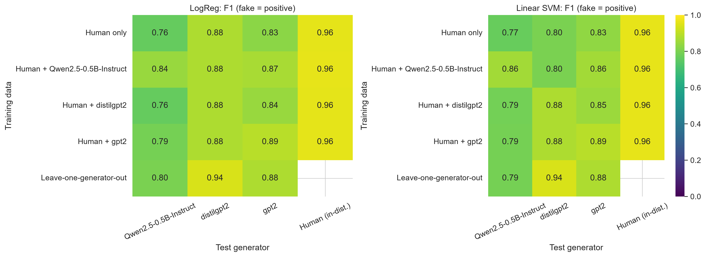
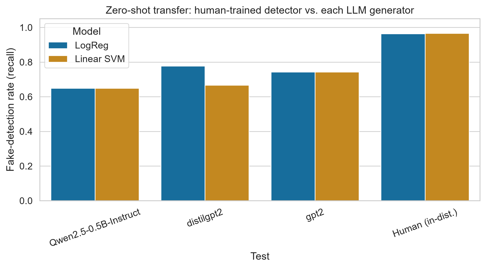
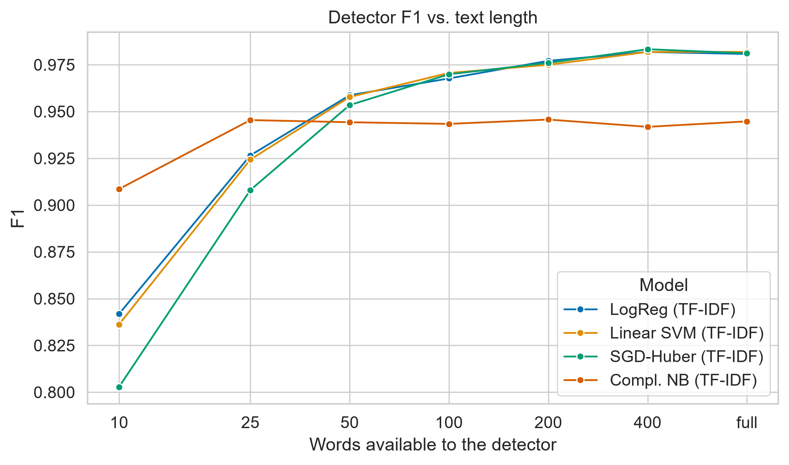
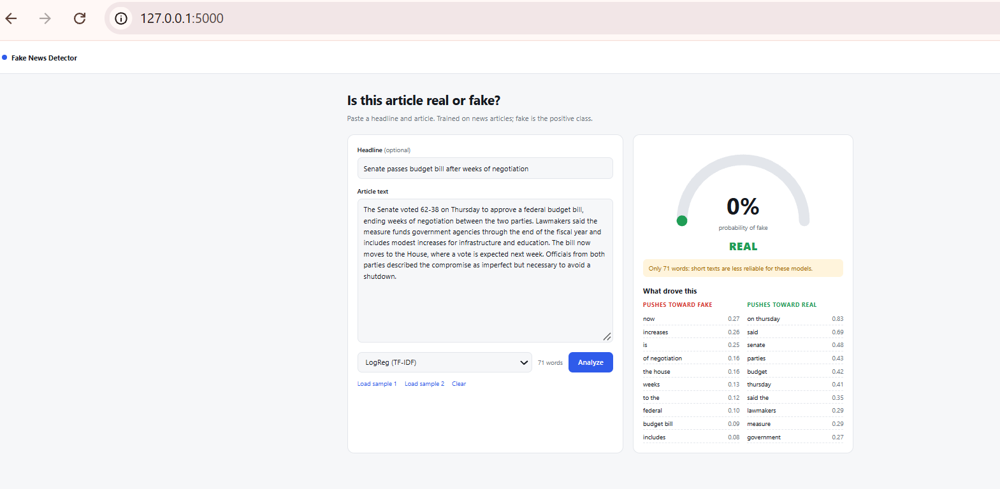

# Detecting Modern LLM-Generated Fake News: A Cross-Generator Robustness Study

How well do fake-news detectors trained on human-written news hold up when the fake text is written by a language model? This project trains five classical detectors (TF-IDF and stylometric), stress-tests them against perturbations, short text, and three unseen LLM generators, and ships them in a small Flask web app.

## Key findings

| Question | Result |
|---|---|
| Accuracy on in-distribution test data | Linear SVM (TF-IDF) is best: F1 = 0.979, AUC = 0.997 |
| Zero-shot transfer to LLM-written fakes | Mean F1 = 0.811 and recall = 0.705, against F1 = 0.961 on human-written fakes |
| Does training on the same generator help? | Yes: +6 to +9 F1 points on that generator, with no loss on human text (F1 stays 0.96) |
| Does training on *other* generators help? | A little: leave-one-generator-out is about +0.04 F1 over zero-shot on the two well-sampled generators |
| Robustness to text noise | Lowercasing, typos, word dropout and sentence shuffling change F1 by 0.004 or less |
| Robustness to short text | Mean F1 falls from 0.972 (full text) to 0.847 at 10 words; only trimming to the first 50 words hurts noticeably among the perturbations (mean F1 0.954) |

The pattern behind the zero-shot numbers: precision stays high (0.92 to 1.00) while recall drops to 0.65 to 0.78. The detectors rarely flag real news by mistake, but they miss roughly a quarter to a third of fakes written by an LLM they have never seen, and Qwen2.5-0.5B-Instruct is the hardest generator to catch.



<p>
  
  
</p>

## Research questions

1. How accurate are TF-IDF and stylometric detectors on clean, held-out news?
2. How robust are they to text perturbations and to short inputs?
3. Can a detector trained only on human news catch fake text from an LLM it has never seen (zero-shot transfer)?
4. Does adding samples from one generator to the training data help against that generator, or against other generators?

## Methodology

1. **Data preparation:** load train, validation and test splits, remove duplicates and cross-split overlap, and scrub source-specific giveaway tokens (agency names, URLs, handles, image credits) so the models cannot rely on them.
2. **Training:** five detectors, tuned on the validation split. Fake is the positive class (label 0 = fake, 1 = real).
3. **Test and robustness evaluation:** one pass over the untouched test split, then perturbation and length stress tests.
4. **Cross-generator detection:** fake news is generated from real fake-news headlines with three open language models (distilgpt2, gpt2, Qwen2.5-0.5B-Instruct). Detectors are evaluated in three settings: human-only training (zero-shot), human plus one generator, and leave-one-generator-out. Every text is truncated to 80 words so length cannot act as a shortcut.

### Models

| Model | Features |
|---|---|
| Logistic Regression | TF-IDF word 1–2-grams |
| Linear SVM | TF-IDF word 1–2-grams |
| SGD (modified Huber) | TF-IDF word 1–2-grams |
| Complement Naive Bayes | TF-IDF word 1–2-grams |
| Gradient Boosting (HistGB) | Stylometric features (length, capitalization, punctuation, lexical diversity, headline style) |

## Results

### In-distribution test set (8,023 articles)

| Model | Accuracy | Precision | Recall | F1 | AUC |
|---|---|---|---|---|---|
| LogReg (TF-IDF) | 0.9788 | 0.9773 | 0.9767 | 0.9770 | 0.9968 |
| Linear SVM (TF-IDF) | 0.9806 | 0.9781 | 0.9797 | 0.9789 | 0.9970 |
| SGD-Huber (TF-IDF) | 0.9806 | 0.9786 | 0.9792 | 0.9789 | 0.9960 |
| Complement NB (TF-IDF) | 0.9425 | 0.9274 | 0.9497 | 0.9384 | 0.9820 |
| HistGB (Stylometric) | 0.9777 | 0.9749 | 0.9767 | 0.9758 | 0.9983 |

### Cross-generator detection

F1 with fake as the positive class. "Zero-shot" means trained on human news only; "+ same generator" adds that generator's texts to training; "leave-one-out" trains on the other generators only.

| Test generator (fake texts in test set) | Model | Zero-shot F1 | Zero-shot recall | + same generator F1 | Leave-one-out F1 |
|---|---|---|---|---|---|
| Qwen2.5-0.5B-Instruct (74) | LogReg | 0.762 | 0.649 | 0.844 | 0.800 |
| Qwen2.5-0.5B-Instruct (74) | Linear SVM | 0.768 | 0.649 | 0.861 | 0.791 |
| gpt2 (74) | LogReg | 0.827 | 0.743 | 0.894 | 0.878 |
| gpt2 (74) | Linear SVM | 0.833 | 0.743 | 0.894 | 0.878 |
| distilgpt2 (9)* | LogReg | 0.875 | 0.778 | 0.875 | 0.941 |
| distilgpt2 (9)* | Linear SVM | 0.800 | 0.667 | 0.875 | 0.941 |

On human-written test news the same models score F1 = 0.96 in every setting, so adding generator data does not cost accuracy on human text. \*distilgpt2 has only 18 usable texts, so one article moves its recall by about 11 points; read its rows as indicative only.

### Robustness

- **Perturbations (TF-IDF models):** lowercase without punctuation, 20% word dropout, 5% typos, shuffled sentences and a removed title all leave F1 within 0.004 of the original (about 0.98 for the best models). Keeping only the first 50 words is the one that hurts (about 0.96).
- **Length:** F1 drops sharply below 50 words, from about 0.97 at 100 words to about 0.93 at 25 words and 0.80 to 0.91 at 10 words. Complement NB is the weakest on full articles but the most robust at 10 words (F1 0.909, against 0.80 to 0.84 for the others).

## Limitations

- Texts from the generators are treated as fake by construction, so a detector may be recognizing "machine-written" style as much as "misinformation". This design cannot separate the two.
- The generators are small open models, not frontier LLMs, and results may not transfer to them.
- The generated articles are short (about 100 words, cut to 80), and distilgpt2 contributes only 18 usable texts.
- Results come from a single train/test split, with no confidence intervals, so differences of a few F1 points between settings should not be over-read.
- Texts under about 80 words are noticeably less reliable.
- A verdict is a statistical estimate, not proof that a story is true or false.

## Web app demo

A Flask app wraps the trained detectors: paste a headline and article, pick a model, and get a fake-probability gauge and a REAL/FAKE verdict, with the words that drove the score. A comparison tab runs all five models, and a results tab shows the notebook tables and figures.

| Fake article | Real article |
|---|---|
|  |  |

```bash
pip install -r requirements.txt
python app.py
```

Open <http://localhost:5000>. The saved models were trained with scikit-learn 1.9.0, so use the same version.

| Endpoint | Method | Description |
|---|---|---|
| `/api/detect` | POST | `{title, text, model}` returns fake probability, verdict, and word contributions |
| `/api/compare` | POST | `{title, text}` returns results from all models |
| `/api/results` | GET | Experiment tables and figure list |

## Reproducing the experiments

Run the notebooks in order from the repo root:

1. `notebooks/1_Data_Preparation.ipynb` (set `DATA_DIR` to the folder with the train, evaluation and test CSVs)
2. `notebooks/2_Train_Models.ipynb`
3. `notebooks/3_Test_Evaluation.ipynb`
4. `notebooks/4_Detection_and_Visualization.ipynb` (set `RUN_GENERATION = True` and `pip install transformers torch` to generate LLM text; a GPU is strongly recommended)

The dataset and the generated texts are not included in this repository.

## Repository structure

```
.
├── notebooks/             # the four experiment notebooks
├── outputs/
│   ├── models/            # trained detectors (phase2_models.joblib)
│   ├── data/              # scrub_patterns.json
│   ├── tables/            # result CSVs
│   └── figures/           # result figures
├── app.py                 # Flask server and API routes
├── detector.py            # scrub(), stylometric features, detect(), explain()
├── templates/, static/    # web page
├── docs/                  # screenshots
└── requirements.txt
```

## Tech stack

Python, scikit-learn, pandas, NumPy, Hugging Face Transformers (generation), Flask, HTML/CSS/JavaScript.

## Author

**Meghana**, [GitHub](https://github.com/meghanasaiyeriginaboina)
